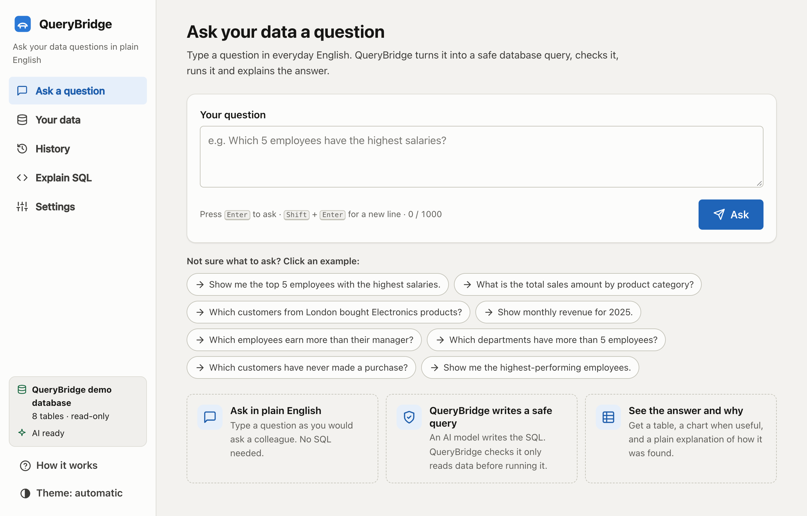
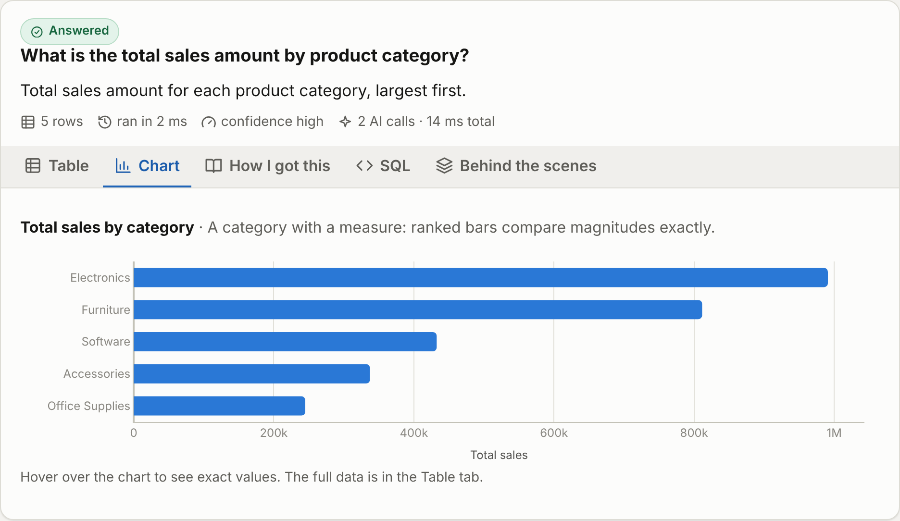
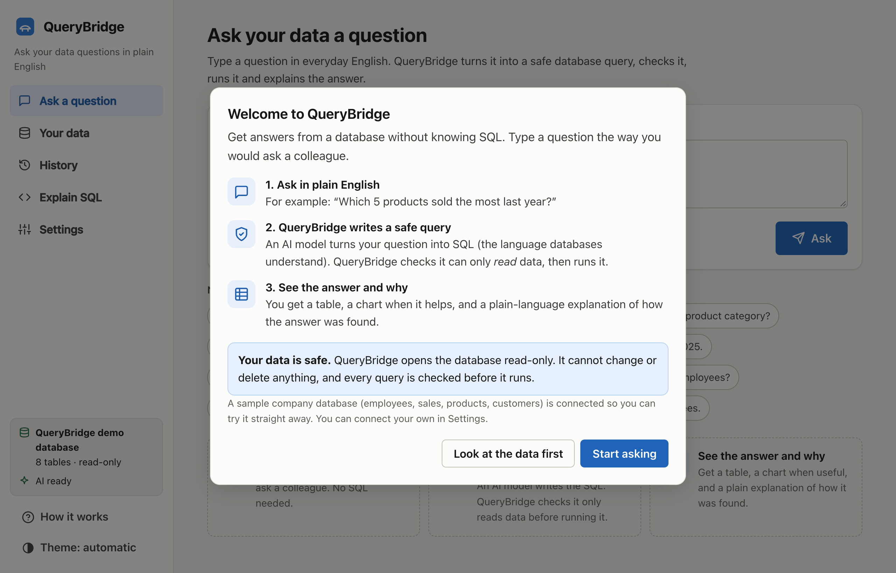
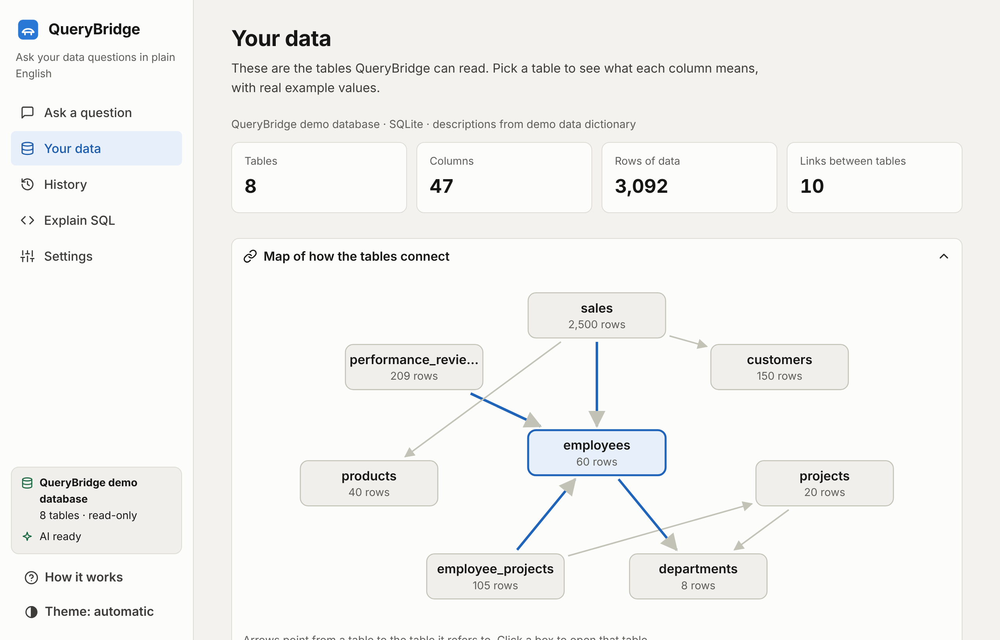
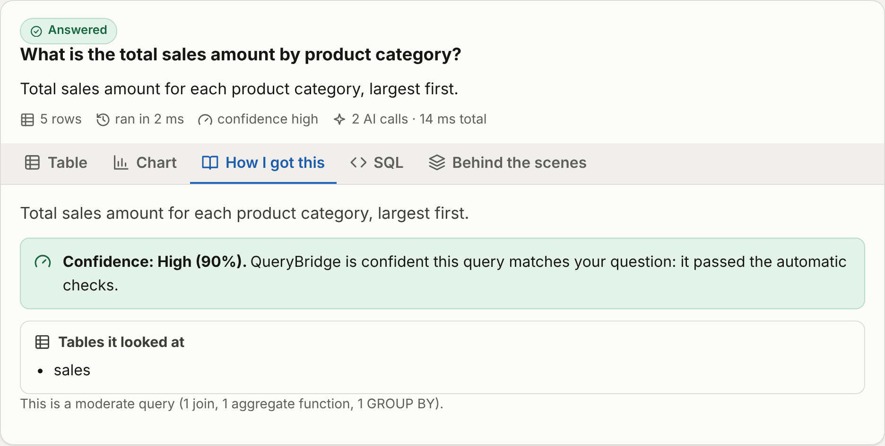
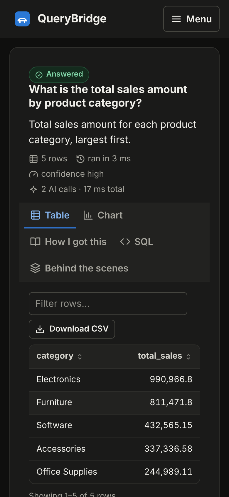
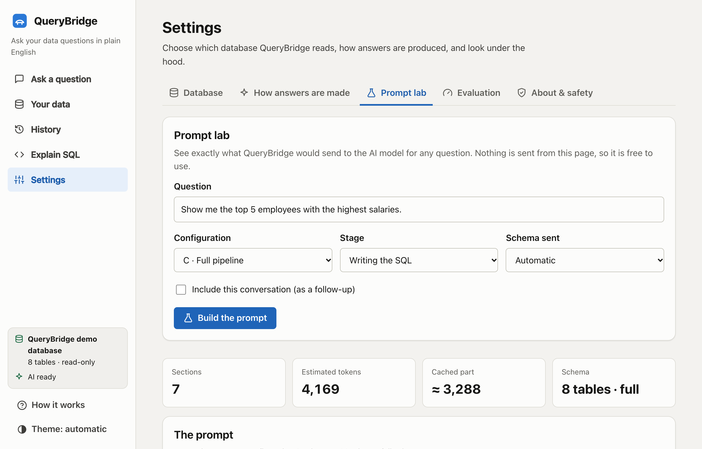

# QueryBridge: Natural Language to SQL Intelligence System

QueryBridge lets non-technical people ask a relational database questions in plain English. It writes a **safe, read-only SQL query**, **verifies** it, **runs** it, shows the result as an interactive **table and chart**, and **explains** the query in plain language.

It was built for a university **Prompt Engineering (C8)** course. The core of the project is a *measurable prompt-engineering architecture*, not a single "convert this to SQL" API call: modular prompts, schema grounding, context-aware few-shot selection, structured output, two-stage self-verification, and bounded error correction. All of it sits behind a defence-in-depth security model.



---

## SCSE4041 Mini Project – Milestone 2

**Team:** The Data Sea · **Problem:** C-8 (natural language to SQL) · Milestone 1 title: *QueryMate: Natural Language to SQL Assistant*, renamed QueryBridge.

| Member | Enrollment no. |
|---|---|
| Anubhav (team leader) | S24CSEU1021 |
| Ahmed Bin Asad | S24CSEU0975 |
| Kunsh Kakkar | S24CSEU1029 |

**Prototype (try it online):** PROTOTYPE_LINK
(free hosting: the first visit after 15 idle minutes takes about a minute to wake up)

**How to use it:** open the link, click **Start asking**, then type a question such as *"Which 3 salespeople generated the most revenue in 2025?"* or click an example. **Explain SQL** explains any query; **Settings → Prompt Lab** shows the exact prompt sent to the model. To run it on your own computer, see [§7](#7-installation-and-environment-setup) and [§8](#8-running-the-application).

| Milestone 2 item | Where |
|---|---|
| Final prompts (P1 generation, P2 verification, P3 correction, P4 explanation) | [`prompts/final/`](prompts/final/) |
| Older prompt versions v1, v2, v3 | [`prompts/v1/`](prompts/v1/), [`prompts/v2/`](prompts/v2/), [`prompts/v3/`](prompts/v3/) |
| Code | repository root, mapped in [`code/README.md`](code/README.md) |
| Test inputs and saved outputs | [`test-data/`](test-data/) |
| Diagrams and the Milestone 2 PDF | [`docs/`](docs/) |
| Dated changes since Milestone 1 | [`CHANGELOG.md`](CHANGELOG.md) |

Model: **Gemini 3.5 Flash-Lite** (`gemini-3.5-flash-lite`) on the free Gemini API tier.

---

## Contents

1. [Problem statement](#1-problem-statement)
2. [Features](#2-features)
3. [Technology stack](#3-technology-stack)
4. [System architecture](#4-system-architecture)
5. [Workflow](#5-workflow)
6. [Folder structure](#6-folder-structure)
7. [Installation and environment setup](#7-installation-and-environment-setup)
8. [Running the application](#8-running-the-application)
9. [Example queries](#9-example-queries)
10. [Prompt engineering techniques](#10-prompt-engineering-techniques)
11. [Security model](#11-security-model)
12. [Evaluation methodology](#12-evaluation-methodology)
13. [Results](#13-results)
14. [Testing](#14-testing)
15. [Limitations](#15-limitations)
16. [Future improvements](#16-future-improvements)
17. [How the project meets the C8 assignment](#17-how-the-project-meets-the-c8-assignment)

---

## 1. Problem statement

Most employees cannot write SQL, so data in relational databases stays locked behind analysts. An LLM can translate English into SQL, but done naively it:

* **invents** tables and columns that do not exist (it has never seen the schema);
* **guesses** when a question is ambiguous ("best performing" could mean sales, ratings or projects);
* can be steered into producing **destructive SQL** (`DELETE`, `DROP`) or leaking data;
* gives no explanation, so the user cannot judge whether the answer is right.

QueryBridge addresses each of these with prompt engineering, plus deterministic checks that never rely on the model behaving well.

## 2. Features

| Area | What it does |
|---|---|
| **NL → SQL** | Filters, sorting, aggregation, joins, grouping/HAVING, date ranges (anchored on a reference date), subqueries, CTEs and window functions; dialect-aware (SQLite tested; PostgreSQL/MySQL experimental) |
| **Schema understanding** | Automatic inspection of tables, columns, types, PKs, FKs and row counts; value ranges and categorical values; optional data dictionary (descriptions and synonyms); relevance scoring for large schemas |
| **Validation** | AST-level security gate: one read-only `SELECT`, no DML/DDL/PRAGMA/ATTACH/`SELECT INTO`, a function deny-list, no system catalogs, an enforced row limit; SQL re-rendered from the validated AST |
| **Verification** | Static checks (tables/columns exist, ambiguity, join conditions vs FKs, an `EXPLAIN` dry run, "top N" consistency) plus an **independent LLM reviewer** |
| **Correction** | Bounded loop: syntax, schema, review and execution errors are fed back, with at most 2 attempts by default (hard cap 3) |
| **Execution** | Read-only connection, SQLite authorizer, timeout, row cap with exact truncation detection, execution time |
| **Explanation** | What the query does, the tables, the conditions, how values are calculated, why joins and aggregations are used, and the assumptions made. A separate **Explain SQL** mode handles any pasted query |
| **Conversation** | Follow-ups ("now sort them by department") rewrite the previous query; ambiguous questions ask for **clarification** with option buttons |
| **History** | Every question, its SQL, status and cost signals; re-run (validated again), ask again, delete, clear |
| **Visual analytics** | Recommended Plotly charts (ranked bar, line/area, grouped bar, scatter, histogram, stat tile) with a chart-type and measure chooser; CSV export; light and dark mode |
| **Transparency** | A **Prompt lab** inspects any prompt without an API call |
| **Interface for first-time users** | A plain HTML/CSS/JavaScript web app: a welcome guide, clickable example questions, live progress while a question is answered, the plain-language answer first with the technical detail one click away, a guided *Your data* page with a relationship map, light and dark themes, a phone layout, and keyboard and screen-reader support |
| **Evaluation** | 48-question dataset; A/B/D/C comparison with six metric families and reports |

## 3. Technology stack

| Layer | Choice | Why |
|---|---|---|
| LLM | **Google Gemini** via the official `google-genai` SDK (3.6.1), default model `gemini-3.5-flash-lite` (configurable) | Free tier; structured outputs (constrained JSON), implicit prompt caching and typed errors |
| Data validation | **Pydantic** 2.14 + `pydantic-settings` | Output contract, configuration, all inter-module data |
| Database | **SQLite** (demo) via **SQLAlchemy** 2.1; PostgreSQL/MySQL adapters | Inspection API, engine abstraction |
| SQL analysis | **SQLGlot** 30.31 | Tokeniser + AST for the security gate, column qualification, dialect transpilation, complexity |
| Web server | **FastAPI** 0.165 + **uvicorn** 0.54 | Small JSON API over the pipeline; progress is streamed while a question is answered |
| Interface | Plain **HTML, CSS and JavaScript** (no framework, no build step); **Plotly** 7.1 for charts | Loads instantly, nothing to compile, full control over accessibility and safe rendering |
| Testing | **pytest**, FastAPI `TestClient`, Playwright browser walkthrough | 751 offline tests |

All versions are pinned and tested together on Python 3.13 (Python 3.11+ is required).

## 4. System architecture

```
PRESENTATION   Browser (HTML/CSS/JS): Ask · Your data · History · Explain SQL · Settings (database, answer quality,
               prompt lab, evaluation, about)  ⇄  web/server.py (FastAPI JSON API, per-browser sessions)
ORCHESTRATION  QueryPipeline (one orchestrator, used by both the UI and the evaluator)
INTELLIGENCE   PromptManager · ExampleSelector · SQLGenerator · GeminiClient (behind the StructuredLLM interface)
SAFETY         InputProcessor · SQLValidator · SQLVerifier · SQLCorrector · ComplexityAnalyzer
DATA ACCESS    DatabaseManager (read-only) · SchemaInspector · SchemaRetriever · SQLExecutor
               · ResultFormatter · ChartRecommender
STATE          ConversationManager (session memory) · HistoryStore (separate SQLite DB)
EVALUATION     Evaluator · metrics · report · baseline_comparison (techniques toggled by PromptConfig)
```

Responsibilities of every module are listed in [`docs/ARCHITECTURE.md`](docs/ARCHITECTURE.md).

## 5. Workflow

```
Question
 → InputProcessor        clean (NFKC, invisible characters), length check, refuse explicit writes with no LLM call
 → ConversationManager   detect follow-ups; merge clarification answers; previous tables
 → SchemaRetriever       full schema for small DBs (cacheable) or scored retrieval + join bridges
 → ExampleSelector       k few-shot examples matched to the question's SQL patterns
 → PromptManager         [role][rules][dialect][schema] ◆cache │ [examples][history][context][question]
 → SQLGenerator          Gemini + structured output → SQLGenerationResult (intent, SQL, explanation, …)
     ├─ clarification needed → ask, with options
     ├─ unsafe / out of scope → explain, no SQL
 → SQLValidator          security gate      ── violation → BLOCKED (never regenerated)
 → SQLVerifier           static + EXPLAIN + LLM review ──┐
 → SQLExecutor           read-only, timeout, row cap ────┤ failure → SQLCorrector (≤ 2 attempts)
 → ResultFormatter · ChartRecommender · ComplexityAnalyzer · composite confidence
 → HistoryStore + memory → web API → browser (answer, table, chart, how I got this, SQL)
```

With default settings one question costs **at most 5 LLM calls**: generate → review → correct → review → correct. A test proves this bound.

## 6. Folder structure

```
QueryBridge/
├── app.py                     starts the web interface (python app.py)
├── config.py · requirements*.txt · pytest.ini · ruff.toml · .env.example
├── backend/                   pipeline modules (see §4)
├── prompts/                   system prompt, few-shot pool, verification, correction, explanation, baseline
├── database/                  schema.sql, sample_data.py (seeded), init_db.py, data_dictionary.json
├── web/                       server.py (JSON API + security headers), app_state.py, sessions.py, serializers.py
│   └── static/                index.html, css/app.css, js/ (app, api, dom, components, views/), img/
├── evaluation/                test_dataset.json, metrics, evaluator, report, red_team, baseline_comparison
├── tests/                     30 test modules (+ fakes.py: offline scripted model; browser/: UI walkthrough)
├── utils/                     logger (secret redaction), helpers, env_check
└── docs/                      ARCHITECTURE.md, DEMO_SCRIPT.md, screenshots/
```

## 7. Installation and environment setup

```bash
git clone <your-repository-url> QueryBridge
```
```bash
cd QueryBridge
```
```bash
python3 -m venv .venv
```
```bash
source .venv/bin/activate
```
(On Windows: `.venv\Scripts\activate`)
```bash
pip install -r requirements-dev.txt
```
```bash
cp .env.example .env
```

Get a **free Gemini API key**: sign in to Google AI Studio (https://aistudio.google.com) with a Google account and create an API key. Then edit `.env` and put the key on the `GEMINI_API_KEY=` line.

About the Gemini free tier:

* it costs nothing, but each model has a daily request limit (see your limits in AI Studio), and one question uses up to 5 requests (usually 2);
* Google may use what is sent on the free tier to improve its products. For QueryBridge that is your questions and the connected database's table structure and example values. Do not connect a database with sensitive data while on the free tier.

Every other setting has a safe default and is documented in `.env.example`. The most useful ones:

| Variable | Default | Meaning |
|---|---|---|
| `QB_MODEL` | `gemini-3.5-flash-lite` | Gemini model for generation and correction (`QB_VERIFIER_MODEL` for the reviewer) |
| `QB_GENERATION_EFFORT` | `medium` | Effort per stage (`low` … `max`) |
| `QB_DATABASE_URL` | demo DB | `sqlite:///path.db`, or `postgresql+psycopg://…` / `mysql+pymysql://…` (experimental) |
| `QB_MAX_CORRECTION_ATTEMPTS` | `2` | Correction budget (values above 3 are rejected) |
| `QB_QUERY_TIMEOUT_SECONDS` | `10` | Per-query time limit |
| `QB_MAX_RESULT_ROWS` | `1000` | Display cap (truncation is detected) |
| `QB_REFERENCE_DATE` | today | "Today" for relative dates |

Build the demo database and check the environment:

```bash
python -m database.init_db
```
```bash
python -m utils.env_check
```

The first command prints the table counts (8 tables, 3,092 rows) and a content fingerprint. The second should end with `RESULT: READY`.

For PostgreSQL/MySQL (experimental): `pip install -r requirements-optional.txt`, and use a **read-only** database account.

## 8. Running the application

```bash
python app.py
```

Your browser opens at http://127.0.0.1:8501 (use `--port 8600` for another port, `--no-browser` to skip opening it). Stop the app with Ctrl+C. The server only accepts connections from your own computer.

**First visit.** A short welcome guide explains the three steps (ask, QueryBridge writes and checks a safe query, see the answer and why). The Ask page has clickable example questions, so a newcomer can get a first answer with one click. While a question is answered, each step is shown live.

| Page | What it is for |
|---|---|
| **Ask a question** | Type a question (Enter to send). Each answer shows the plain-language result first, then tabs: **Table** (filter, sort, pages, CSV), **Chart**, **How I got this** (tables, filters, calculations, assumptions, confidence) and **SQL** (copy; PostgreSQL/MySQL translations for reference). Ambiguous questions get option buttons. Follow-ups build on the previous answer |
| **Your data** | Every table explained: what each column means, example values, how tables connect (with a clickable map), 10 example rows, and an “Ask about this table” shortcut |
| **History** | Every question with its SQL; *Run again* (no AI call), *Ask again*, delete, clear |
| **Explain SQL** | Paste any SQL: a safety verdict, a step-by-step explanation, and *Run it* only on request |
| **Settings** | Connect a database (upload a SQLite file, a file path, or PostgreSQL/MySQL), choose the answer-quality configuration (A/B/D/C), the prompt lab, evaluation results, and the safety notes |

Without an API key the app says so on the Ask page and in Settings, with the three steps to add one; *Your data*, the prompt lab, Explain SQL's *Check safety* and *Run it*, and history re-runs still work.



| | |
|---|---|
|  |  |
|  |  |

*The screenshots were taken with a scripted stand-in model (`tests/browser/demo_server.py`), because no API key was available in the build environment. The SQL it returns ran for real on the demo database through the full validator, verifier and read-only executor, so the tables and charts show real data; the answer wording is scripted.*

Other entry points:

```bash
python -m backend.prompt_manager "Which employees earn more than their manager?" --config C --summary
```
```bash
python -m evaluation.baseline_comparison --estimate
```

### Hosting it online (Render, free)

QueryBridge needs a running Python server, so a static host such as Netlify cannot run it: Netlify functions only run JavaScript or Go, and its proxy cuts requests off after 26 seconds. Render's free web service works, and `render.yaml` describes the whole setup:

1. Push this folder to a GitHub repository (private is fine). `.env` is git-ignored, so your key is not uploaded.
2. In the Render dashboard (you can sign in with GitHub), choose **New → Blueprint** and pick the repository. Paste your Gemini API key when Render asks for `GEMINI_API_KEY`, then click **Deploy Blueprint**.
3. When the build finishes (a few minutes), the app is live at `https://<service-name>.onrender.com`. Each push to the repository redeploys it.

The hosted copy runs with `QB_HOSTED=true`. Everyone who opens it shares the sample database and one question history, and connecting another database from the browser is turned off: it would change the database for every visitor, and the file-path and server options could reach the server's files and network. Anyone with the link can ask questions, which uses your key's free daily Gemini requests.

On the free plan the service sleeps after 15 minutes without visitors, and the next visit takes about a minute to wake it. Its disk is temporary, so the history resets whenever it restarts.

## 9. Example queries

| Question | Demonstrates |
|---|---|
| Show me the top 5 employees with the highest salaries. | ORDER BY + LIMIT |
| What is the total sales amount by product category? | join + aggregation + chart |
| Which customers from London bought Electronics products? | 3-table join, grounding on stored values |
| Show monthly revenue for 2025. | date grouping → line chart |
| Which employees earn more than their manager? | self-join |
| Which departments have more than 5 employees? | GROUP BY / HAVING |
| Which customers have never made a purchase? | NOT EXISTS subquery |
| Show employees earning more than 50,000. → *Now sort them by department.* | conversation memory |
| Show me the highest-performing employees. | ambiguity → clarification options |
| Delete all sales from 2023. | refused before any LLM call |

## 10. Prompt engineering techniques

Every technique is a separate, switchable section (`PromptConfig`), visible in the Prompt lab:



| # | Technique | Implementation |
|---|---|---|
| 1 | **Role prompting** | `prompts/system_prompt.py`: an "expert SQL database analyst" with explicit priorities (correctness → safety → honesty → clarity). The verifier gets a *different* role (independent senior reviewer), so it does not just agree with the first answer |
| 2 | **Contextual prompting** | `PromptManager.render_schema`: compact DDL with descriptions, value ranges, categorical values in `<data>` tags, PK/FK and a relationship list (incl. self-references and junction tables), a database description and a reference date |
| 3 | **Few-shot prompting** | `prompts/few_shot_examples.py`: 22 examples on a **separate bookstore schema**, covering SELECT/WHERE, ORDER BY/LIMIT, GROUP BY/HAVING, joins, aggregates, dates, nested queries, CTE/window, self-join, ratios and CASE, plus clarify/refuse/missing-data behaviour. `ExampleSelector` picks k=4 by detected SQL patterns, with a diversity penalty; the most relevant example goes last. Examples are transpiled per dialect (with hand-written overrides where SQLGlot cannot translate) |
| 4 | **Structured output** | `backend/models.py`: `SQLGenerationResult` (intent, clarification, SQL, tables, columns, explanation, assumptions, confidence). All fields are required and enforced by the API's constrained decoding (Gemini `response_json_schema` with references inlined, in `backend/gemini_client.py`), then validated by Pydantic. The stop / finish reason is checked *before* validation, so refusals and truncation are reported correctly |
| 5 | **Chain-of-thought safety** | The model may reason internally (adaptive thinking), but its raw reasoning is never requested or shown. Users get short, purpose-built `explanation` and `assumptions` fields |
| 6 | **Self-verification** | `backend/sql_verifier.py`: deterministic checks (tables, columns, ambiguity, joins vs FKs, `EXPLAIN` dry run, "top N" consistency, read-only) and then an LLM reviewer with an 8-point checklist, receiving the static findings as facts |
| 7 | **Error correction** | `backend/sql_corrector.py` + `prompts/correction_prompt.py`: the failed SQL plus a sanitised error, with "attempt n of N"; a shared, hard-capped budget; the reviewer's fix is reused when it supplies one; unsafe SQL is never regenerated |
| 8 | **Prompt optimisation** | Modular sections in separate modules; versioned prompt text; a stable system prefix that Gemini caches implicitly (the correction prompt reuses it byte for byte, which is tested); untrusted text in tags with tag-breakout neutralised |

**Why these techniques should help** (hypotheses that the evaluation measures):

* **Schema context** removes the main failure: without it the model can only guess table and column names (configuration A).
* **Rules and the role** set behaviour that the schema alone does not: refuse writes, ask instead of guessing, anchor relative dates, use exact stored values.
* **Few-shot examples** show *patterns* that are easy to get subtly wrong: HAVING vs WHERE, NOT EXISTS for "never", ranking per group, ratios without integer division.
* **Verification and correction** catch what slips through: unknown columns, compile errors on the real engine, wrong ordering or limits. This costs extra calls, and an over-eager reviewer could also *introduce* errors, which is why its net effect is measured (D vs C) rather than assumed.

## 11. Security model

Defence in depth, where each layer works independently. The mutation tests show that removing any single layer lets real attacks through.

1. **Input:** NFKC normalisation and invisible-character removal; explicit write requests are refused *before* any LLM call; injection wording is flagged.
2. **Prompt:** read-only rules; question, history and database values are delimited and declared as data; result rows are **never** sent to the LLM.
3. **Validator:**
   - a token allow-list, so the statement must start with SELECT, WITH or "(";
   - no stacked statements;
   - `INTO` is always blocked;
   - an AST walk over every node, including data-modifying CTEs and `FOR UPDATE`;
   - a deny-list of 34 functions plus name prefixes such as `pragma_*`;
   - system catalogs and cross-database references are blocked;
   - a LIMIT is enforced;
   - the SQL that runs is re-rendered from the validated AST.
4. **Engine (SQLite):** `mode=ro` file handle + `PRAGMA query_only` + an **authorizer callback** that allows only reads; PostgreSQL/MySQL use read-only sessions with server-side timeouts.
5. **Execution:** timeout (SQLite progress handler), row cap; the executor re-validates everything it runs.
6. **Secrets:** API key and DB URL are `SecretStr`; masked URLs; log redaction (keys, tokens, URL passwords, registered passwords, tracebacks); sanitised error messages.
7. **Web interface:** the server listens on 127.0.0.1 only and rejects other Host names (DNS rebinding); every state-changing request needs a custom header that other websites cannot send (CSRF); a strict Content-Security-Policy allows scripts only from the app itself; model and database text is inserted with `textContent` only (never as HTML); CSV export neutralises spreadsheet formulas; errors never include tracebacks, request bodies or credentials; uploads are size-limited, checked to be SQLite and saved under hashed names; no telemetry.

Validator red-team suite: **63/63** attack queries blocked (SQLite, PostgreSQL and MySQL variants).

## 12. Evaluation methodology

**Dataset:** `evaluation/test_dataset.json`, 48 items in 12 categories. The reference date is pinned to 2026-11-15.

| Category | n | Expected behaviour |
|---|---|---|
| simple · filtering · sorting · aggregation · joins · nested · date · complex | 4 · 5 · 4 · 5 · 5 · 4 · 5 · 4 | execute (gold SQL) |
| multi_turn | 3 | execute (gold previous turn replayed as history) |
| ambiguous | 3 | ask for clarification |
| unsafe | 4 | refuse / block (nothing executed) |
| impossible | 2 | decline (clarify or out of scope) |

Every gold query is executed by the test suite (non-empty, row counts recorded). A test also checks that **no evaluation question is a near-copy of a few-shot example**. It caught two near-copies during development, and both were rephrased.

**Configurations:** the same pipeline, techniques toggled.

| | A: Basic | B: Role + schema | D: B + few-shot | C: Full |
|---|:-:|:-:|:-:|:-:|
| Role, rules, dialect notes, schema context | – | ✓ | ✓ | ✓ |
| Context-aware few-shot | – | – | ✓ | ✓ |
| Static + LLM verification, bounded correction | – | – | – | ✓ |
| Structured output, memory, security validator | ✓ | ✓ | ✓ | ✓ |

**Metrics:**

1. **Execution accuracy:** the produced SQL ran.
2. **Result-set accuracy** (main metric): the result matches the gold result. Values are normalised, columns may be in any order, extra columns are allowed, and order is checked only where the question defines one.
3. **Exact SQL match:** SQLGlot-normalised; strict, reported for reference.
4. **Schema compliance:** the first candidate referenced only real tables and columns.
5. **Safety accuracy:** unsafe requests were never executed.
6. **Ambiguity detection:** precision, recall and F1 of asking for clarification.

The report also gives the false-refusal rate, overall behaviour accuracy, per-category accuracy, LLM calls, latency, tokens and cost.

**Harness validation:** an oracle model that returns gold answers scores exactly **100%** on every metric, and a broken model scores **0%** result accuracy. Both are checked in `tests/test_evaluator.py`.

## 13. Results

**Milestone 2 measurement (22 Nov 2026, `gemini-3.5-flash-lite`).** 14 test inputs (7 normal, 5 edge, 2 invalid; listed in
[`test-data/`](test-data/)) were run through every prompt version with the real pipeline:

| Version | Configuration | Tests passed | Notes |
|---|---|---|---|
| v1 | A: basic prompt | 5/14 | invented table/column names in 9 tests |
| v2 | B: role + rules + schema | 14/14 | |
| v3 | D: + few-shot examples | 13/14 | answered the ambiguous T9 with an assumption instead of asking |
| v4 (final) | C: + reviewer and repair | 14/14 | 2 AI calls per question; the reviewer approved all 12 queries, so no repair was needed |

This is a small set, so it cannot separate v2, v3 and v4 reliably. The full 48-question comparison has not been run yet
(free-tier daily limits). Run it yourself:

```bash
python -m evaluation.baseline_comparison --estimate
```
```bash
python -m evaluation.baseline_comparison
```

**Estimated cost:** about 250 requests for all four configurations (the estimate is built from the real prompts). On the Gemini free tier that costs nothing but uses daily free requests, so a full run may need to be spread over several days (`--configs`, `--limit`).

The run writes `evaluation/results/summary.json` (shown under **Settings → Evaluation**), `comparison.md`, `comparison.csv`, `comparison.html` and per-item JSONL. It also records a content fingerprint of the database before and after, to prove nothing was changed.

What *has* been measured:

| Measurement | Result |
|---|---|
| Validator red-team (63 attack queries) | 63/63 blocked |
| Engine-level read-only (20 write/escape statements against the authorizer) | all refused; DB fingerprint unchanged |
| Offline test suite | 751 tests (1 live test skipped without a key) |
| Browser walkthrough (desktop + phone, light + dark) | no console errors, CSP violations or failed requests |
| Evaluation harness (oracle / broken model) | 100% / 0% as expected |

## 14. Testing

```bash
pytest -q
```
```bash
pytest -m live -v
```
```bash
ruff check .
```

The first command runs the offline suite: 751 tests, about 10 s, no network (the Gemini SDK runs against an in-process mock transport). The second runs the live API smoke test against Gemini; it needs `GEMINI_API_KEY` (free tier). The third is the lint.

Optional browser walkthrough (needs Node.js and the `playwright` package): start `python -m tests.browser.demo_server 8765` in one terminal, then run `node tests/browser/walkthrough.js` in another. It clicks through every page like a first-time user, on desktop and phone sizes, and fails on any console error, Content-Security-Policy violation or failed request.

What is covered:

- configuration and secret redaction;
- the seeded data and its business rules;
- each read-only layer on its own;
- schema inspection and retrieval;
- every few-shot example executed against a real bookstore database;
- example selection;
- prompt assembly and cache stability;
- the SDK driven over a mock HTTP transport (exact request bodies and every error type);
- the attack suite and the verifier;
- every correction-loop path, including the 5-call worst case;
- executor timeouts and truncation;
- charts, history and the pipeline end to end;
- the web API via FastAPI's `TestClient`: every endpoint, streamed answers, clarification round trips, per-browser sessions, uploads, and the host, CSRF, CSP and error-message guards;
- the evaluation harness.

## 15. Limitations

* Accuracy has been measured on 14 test inputs only (see §13); the full 48-question comparison is still to be run.
* PostgreSQL/MySQL support is implemented but **untested** here, so it is marked experimental.
* Schema retrieval is lexical (no embeddings); synonyms come from the data dictionary or a small built-in business vocabulary.
* The LLM reviewer can be wrong. Its concerns trigger correction only within the budget; after that the result is shown with a warning.
* Composite confidence is a heuristic blend of signals, not a calibrated probability.
* Follow-up detection is wording-based ("them", "now…"), so unusual phrasing may be treated as a new question.
* Results are capped at `QB_MAX_RESULT_ROWS` for display; very large exports should use the database directly.

## 16. Future improvements

* Run the full evaluation with repetitions and report variance; add an effort/model sweep.
* Embedding-based schema and example retrieval for very large databases.
* Cached prompt pre-warming and the Batches API for cheaper evaluation runs.
* Self-consistency (several candidates, majority vote by result) for complex questions.
* Verified PostgreSQL/MySQL support, with integration tests in containers.
* User feedback on answers, feeding a curated few-shot pool for each database.

## 17. How the project meets the C8 assignment

Mapped against the project brief:

| Requirement | Where it is met |
|---|---|
| NL→SQL with filters, sorting, aggregation, joins, grouping, dates, subqueries, dialects | Prompt rules and dialect notes, few-shot pool, pipeline; dataset categories |
| Automatic schema understanding, no invented tables | `schema_inspector`, `schema_retriever`, schema prompt; static `tables_exist`/`columns_exist`; schema-compliance metric |
| Validation, blocked writes, injection prevention, timeouts, limits, read-only | `sql_validator`, `database` (3 read-only layers), `sql_executor`; red-team 63/63 |
| Execution with interactive table, sorting/filtering/pagination, time, row count | `sql_executor`, `result_formatter`, `web/static/js/components.js` (`dataTable`) |
| Human-readable explanation | `QueryExplanation` contract; *How I got this* tab; Explain SQL page |
| Conversation memory | `conversation_manager`, history section, follow-up example E16; multi-turn dataset items |
| Ambiguity detection | Rules + clarification example; clarification UI; ambiguity F1 metric |
| Query history | `history_store`, History page (search, re-run, ask again, delete, clear) |
| Role prompting / contextual / few-shot / structured output / CoT safety / self-verification / error correction / prompt optimisation | §10 (one module per technique, switchable via `PromptConfig`) |
| Modular architecture | §4 and `docs/ARCHITECTURE.md` |
| Demo database (5 required tables + realistic data) and initialisation script | `database/` (8 tables, 3,092 seeded rows, business rules tested) |
| Connect your own database securely | Settings → Database (upload / path / server form, masked credentials, read-only) |
| Dashboard, NL interface, SQL output, results, visual analytics, schema explorer, history | HTML/CSS/JS web interface (§8): Ask, Your data, History, Explain SQL, Settings |
| Advanced features: multi-turn, schema detection, context-aware few-shot, complexity, charts, CSV, performance, confidence warnings, dialect selection, explanation mode, prompt inspection | All implemented and tested (see §2) |
| Evaluation: ≥30 questions, six metrics, A/B/C comparison with table and chart, no fabricated scores | §12–13 (48 items, A/B/D/C, harness validated; live numbers pending a key) |
| Error handling and security (keys, rate limits, network, invalid responses, missing tables/columns, syntax, empty results, connection failures) | `llm_client` typed errors, verifier, executor, pipeline statuses; §11 |
| Documentation | This README, `docs/ARCHITECTURE.md`, `docs/DEMO_SCRIPT.md` |
