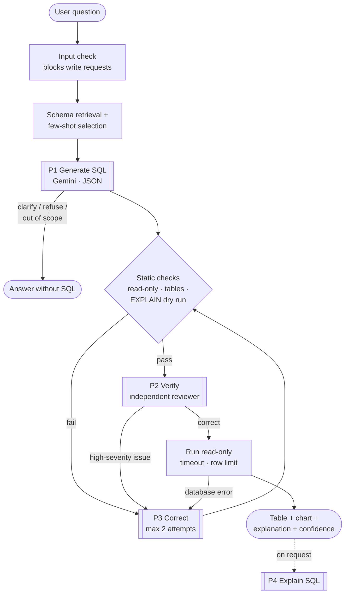
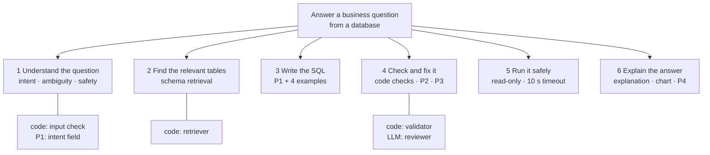
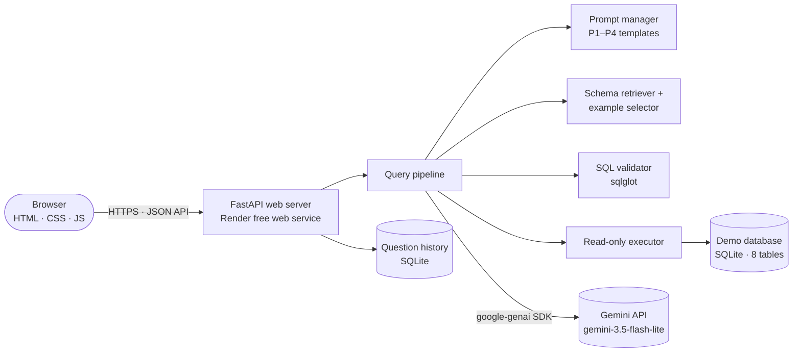
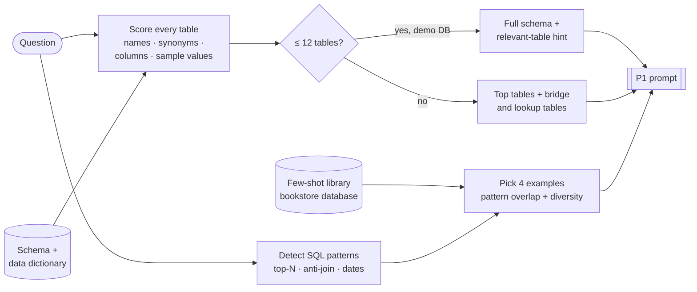
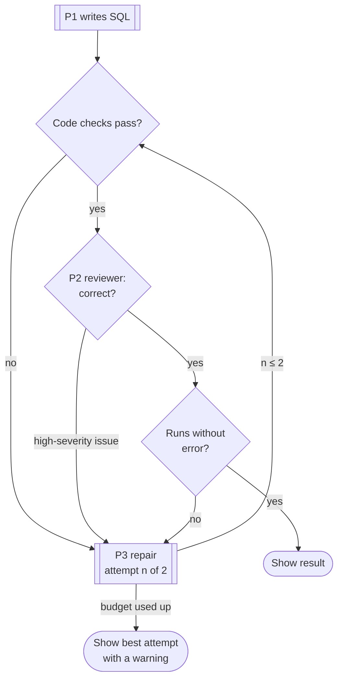

# Milestone 2 diagrams (Mermaid source; GitHub renders them)

## Figure 1 – Prompt workflow

## Figure 2 – Task decomposition

## Figure 3 – Input–output flow

```mermaid
flowchart LR
  subgraph IN [Inputs]
    direction TB
    I1[Question in English<br/>or Hinglish]
    I2[Database schema +<br/>data dictionary]
    I3[Conversation history<br/>for follow-ups]
    I4[Reference date]
  end
  subgraph OUT [Outputs]
    direction TB
    O1[Read-only SQL query]
    O2[Result table]
    O3[Chart when useful]
    O4[Plain-English explanation<br/>+ assumptions]
    O5[Confidence + review verdict]
    O6[Or: clarifying question /<br/>refusal / out-of-scope note]
  end
  IN --> PIPE[QueryBridge pipeline<br/>P1 → checks → P2 → P3 → run] --> OUT
```

## Figure 4 – System architecture

## Figure 5 – Retrieval pipeline

## Figure 6 – Self-correction loop

